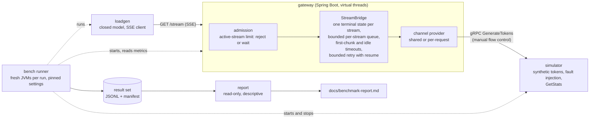
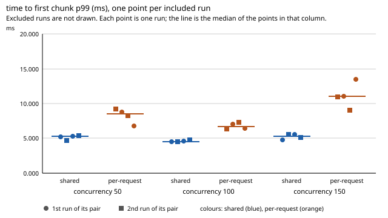

# streaming-reliability-lab

A small but real transport layer for token streaming, used to show connection
lifecycle, bounded concurrency, backpressure and recovery after failure.
Everything is synthetic: no real LLM, no API key.

> Status: **stage 1 in progress.** The gRPC contract, the simulator, the gateway (SSE bridge, bounded resources,
> timeouts and cancellation, bounded reconnect, two connection modes), the load generator, the benchmark runner and the
> report tool are done and tested. One full benchmark result set (24 runs on one Azure VM) has been run and analysed;
> see [Results](#results). It describes that set on that machine only.

## Problem

A streaming gateway sits between many clients and an upstream token producer.
Under load and failure it must keep these contracts:

- queues and active requests are bounded; overload is rejected or delayed explicitly
- cancelling or timing out a client request stops the upstream work
- every request reaches exactly one terminal state
- shutdown finishes within a known time

The lab compares two connection strategies (a new channel per request vs. one
shared, lifecycle-managed channel) under the same load, payload and failure policy.

## Architecture



A client opens `GET /stream`. The gateway admits the stream (or answers 503 when the active-stream limit is reached),
takes an upstream channel from the channel provider (one shared channel, or one channel per stream, selected by
`lab.connection-mode`) and relays the simulator's chunks as Server-Sent Events. Each stream has a bounded queue and
the upstream is paused by flow control when the client is slow. A timeout, an upstream error, a client disconnect or a
shutdown ends the stream through a single terminal claim, so it gets exactly one terminal event and releases its
permit and channel once. `bench` runs the whole set-up on one machine for the benchmark, and `report` reads the
result. Details: [Gateway](#gateway), [ADR-0002](docs/adr/0002-single-terminal-claim.md),
[ADR-0003](docs/adr/0003-per-request-connection-mode.md).

## Quick start

Requirements: JDK 26. Build everything once:

```bash
./mvnw -B package -DskipTests
```

Terminal 1, the simulator (port `50051`):

```bash
./mvnw -q -pl simulator -am install -DskipTests
./mvnw -q -pl simulator exec:java
```

Terminal 2, the gateway (port `8080`, shared connection mode by default):

```bash
java -jar gateway/target/gateway-0.1.0-SNAPSHOT.jar
```

Terminal 3, open one stream (on Windows PowerShell use `curl.exe`):

```bash
curl -N "http://localhost:8080/stream?chunks=5&intervalMs=100&seed=7"
```

You get `chunk` events and one final `complete` event. To use the other connection mode, start the gateway with
`--lab.connection-mode=per-request`. To check the gateway: `curl http://localhost:8080/actuator/health/readiness` and
`curl http://localhost:8080/actuator/metrics/active_streams`. To run the tests: `./mvnw verify`. To run the benchmark,
see [Benchmark protocol](#benchmark-protocol); to load the gateway by hand, see [Load generator](#load-generator).

## Results

One full benchmark result set exists: run `20261029T105937Z-b117ff0-dirty`, 24 runs (concurrency 50, 100 and 150,
both connection modes, 4 repetitions each, ABBA order, 60 s measured and 20 s warm-up per run) on one Azure VM
(Standard_D4als_v6: 4 vCPU on 2 physical cores, Ubuntu 24.04, Sweden Central, JDK 26). All 24 runs were usable and none
carries a stability flag besides `GIT_DIRTY` at set level. Median of the per-run values over 4 repetitions per mode:

| Concurrency | Time to first chunk p50 (ms), shared / per-request | Time to first chunk p99 (ms), shared / per-request | Total stream p50 (ms), shared / per-request | Rejected requests |
|---|---|---|---|---|
| 50 | 1.43 / 2.41 | 5.27 / 8.55 | 1954.59 / 1955.49 | 0 % |
| 100 | 1.20 / 1.82 | 4.56 / 6.73 | 1954.34 / 1954.94 | 0 % |
| 150 | 0.75 / 1.54 | 5.32 / 11.03 | 1953.82 / 1954.83 | 90.1 % in both modes |



What the set shows: in this set the per-request mode had a higher time to first chunk than the shared mode at every
concurrency, with non-overlapping ranges and a difference larger than the spread within a mode. In absolute terms the
differences are small (about 0.6 to 1.0 ms at p50 on streams of about 1955 ms). Streams per second and the
inter-chunk gap at concurrency 50 and 100 could not be separated between the modes. At concurrency 150 the active
stream limit of 100 rejects about 90 % of the requests in both modes, so the rate there is set by the limit, not by the
gateway's capacity.

What it does not show: a cause, anything about a real network or LLM, or a capacity. Everything is synthetic and runs
on one host that shares its two physical cores between the load generator, gateway and simulator; the load model is
closed (coordinated omission is not corrected) and each cell has 4 repetitions. The first requests of every measured
phase are slower (about 90 to 170 ms at the maximum), probably because the load generator JVM is fresh; the p99 values
above do not appear to be affected by it, but this was not tested. The TIME_WAIT count recorded before a run is exactly
803 in 13 of the 24 runs, which looks like a kernel limit; this has not been verified and is not analysed. The full report, with every run, the data checks and the
limits, is [docs/benchmark-report.md](docs/benchmark-report.md), and the derived tables are in `docs/benchmark/`.

## Out of scope

Chat UI, user accounts, RAG, vector databases, multi-cloud, Kubernetes.

## Modules

| Module | Purpose | State |
|---|---|---|
| `proto/` | `TokenStreamService` and `SimulatorAdminService` contract | done |
| `simulator/` | Synthetic gRPC token producer with timing and fault injection | done |
| `gateway/` | Spring Boot SSE gateway: lifecycle, bounded queue, gRPC adapter | shared channel + selectable connection modes (shared / per-request) + SSE bridge + bounded resources (limit, per-stream queue, metrics) + first-chunk/idle timeouts and upstream-cancel checks + bounded reconnect (retry with backoff, resume) done |
| `loadgen/` | Load generator client: closed model + linear ramp, raw JSONL + convenience summary (HdrHistogram); open model deferred | closed model done; no performance claim |
| `bench/` | Benchmark protocol runner: per-run fresh JVMs, pinned settings, ABBA run order, raw results + manifest (no analysis) | runner + protocol v1 done; one full set run (see status) |
| `report/` | Benchmark report tool: reads one result set read-only, writes a descriptive report, CSV/JSON tables and SVG dot plots (no inference) | tool done; one result set analysed ([report](docs/benchmark-report.md)); describes that set only |

## Simulator

Every chunk is a pure function of `(seed, request_id, seq)`, so a stream resumed
with `resume_from_seq` is byte-identical to the original suffix.

| Request field | Effect |
|---|---|
| `profile.first_chunk_delay_ms` | delay before the first chunk |
| `profile.chunk_count` | total chunks, `seq` 0..n-1 |
| `profile.chunk_interval_ms` | delay between chunks |
| `profile.chunk_size_bytes` | approximate payload size |
| `fault.type` / `fault.at_seq` | `UNAVAILABLE`, `INTERNAL`, or `HANG` instead of chunk `at_seq` |
| `resume_from_seq` | first seq to emit |

The simulator respects gRPC flow control: when the transport is not ready it
pauses instead of buffering, and counts the pause. `SimulatorAdminService.GetStats`
exposes `active_generations`, so tests can prove that upstream work stopped after
a cancel, deadline or shutdown.

Abrupt connection loss is not simulated in-process. It will be injected with
Toxiproxy between gateway and simulator.

## Run

Requirements: JDK 26.

```bash
./mvnw verify
```

`verify` also measures test coverage with JaCoCo (0.8.15, the first release that supports
Java 26). Each module with tests writes an HTML report to `<module>/target/site/jacoco/index.html`
and an XML report to `<module>/target/site/jacoco/jacoco.xml`, which the Sonar step in the CI
workflow reads. The `proto` module has no tests and produces no report.

Start the simulator as in [Quick start](#quick-start) (port `50051`, override with `SIMULATOR_PORT`). With reflection
enabled you can call it using `grpcurl`:

```bash
grpcurl -plaintext -d '{"request_id":"demo","seed":7,"profile":{"chunk_count":5,"chunk_interval_ms":100}}' \
  localhost:50051 streamlab.tokenstream.v1.TokenStreamService/GenerateTokens
```

| Environment variable | Default |
|---|---|
| `SIMULATOR_PORT` | `50051` |
| `SIMULATOR_SHUTDOWN_GRACE_SECONDS` | `10` |
| `SIMULATOR_SCHEDULER_THREADS` | available processors |

## Gateway

`GET /stream` opens one upstream gRPC call and relays its chunks as Server-Sent Events. Every stream ends with exactly
one `complete` or `error` event (except when the client is gone). Query parameters: `chunks`, `firstDelayMs`,
`intervalMs`, `fault`, `faultAtSeq`, `seed`. The full reference, with settings and known limits, is in
[docs/gateway.md](docs/gateway.md):

- **Bounded resources:** an active-stream limit (`reject` with 503, or `wait`), a bounded queue per stream and manual
  upstream flow control, so a slow client pauses the upstream instead of growing a buffer. Metrics: `active_streams`,
  `queue_depth`, `rejected_total`, `timeouts_total`, `retries_total`, `connection_mode`.
- **Timeouts and cancellation:** a first-chunk and an idle timer. Timeouts, client disconnects and shutdown cancel the
  upstream work.
- **Connection modes:** `lab.connection-mode` is `shared` (one lifecycle-managed channel, the default) or
  `per-request` (one channel per stream).
- **Bounded reconnect:** `UNAVAILABLE` is retried with exponential backoff and jitter and resumed at the next chunk,
  within the stream deadline.
- **Stream contract tests:** the guarantees (one terminal event, permit and lease released once, upstream cancelled, no
  timer leak, bounded queue) are one contract that runs on the real bridge and on a deliberately flawed handler; see
  [docs/failure-analysis.md](docs/failure-analysis.md).

## Load generator

`loadgen/` is a command line client that opens many SSE streams against `GET /stream` and writes one raw JSONL record
per request plus a convenience summary (HdrHistogram). The model is closed: `--concurrency` workers each open the next
stream when the previous one ended. The open model is deferred ([ADR-0004](docs/adr/0004-loadgen-closed-model-raw-output.md))
and coordinated omission is not corrected. With the simulator and the gateway running (see [Quick start](#quick-start)):

```bash
./mvnw -B -pl loadgen package -DskipTests
mkdir -p results/raw
java -jar loadgen/target/loadgen-0.1.0-SNAPSHOT.jar \
  --target http://localhost:8080/stream --concurrency 10 --duration 30s --ramp-up 5s \
  --chunks 20 --interval-ms 20 --seed 42 \
  --output results/raw/run.jsonl --summary-output results/raw/summary.json
```

`target/lib/` must stay next to the jar. Options, output schema, outcomes, what is measured and what is not:
[docs/loadgen.md](docs/loadgen.md).

## Benchmark protocol

`bench/` runs the written [benchmark protocol](docs/benchmark-protocol.md) (protocol version 1): for every cell
(concurrency x connection mode x repetition) it starts a fresh simulator and gateway JVM, waits for readiness within
fixed bounds, verifies the connection mode from the `connection_mode` metric, runs a warm-up and a measured loadgen
run, takes metric snapshots before and after, stops the processes and checks that the ports are free. Raw files and a
`manifest.json` land in `bench/results/<run-id>/` (ignored by git). The runner only records raw data and stability
flags; it analyses and ranks nothing.

```bash
./mvnw -B package -DskipTests                                        # the runner never builds; run this first
java -jar bench/target/bench-0.1.0-SNAPSHOT.jar --dry-run            # plan and exact commands, starts nothing
java -jar bench/target/bench-0.1.0-SNAPSHOT.jar --preset smoke --dry-run
java -jar bench/target/bench-0.1.0-SNAPSHOT.jar --preset smoke --checklist yes   # short harness check (4 runs)
java -jar bench/target/bench-0.1.0-SNAPSHOT.jar                      # default set: 24 runs, nominal duration printed by --dry-run
java -jar bench/target/bench-0.1.0-SNAPSHOT.jar --help
```

- Before a run set the operator checklist (other applications closed, AC power, power plan) is asked; `--checklist ask`
  needs an interactive terminal (otherwise exit code 2), `--checklist yes|skip` records the answer without asking.
  A `no` or a skipped checklist hides nothing, it only adds a flag.
- Exit codes: 0 all planned runs completed (flags do not change it); 1 harness or run failure (the manifest says
  `failed`; the cases where no manifest could be written are in protocol sections 8 and 11); 2 invalid arguments or
  failed precondition (nothing started, no directory created).
- Windows: `Process.destroy()` is a hard termination, so the graceful shutdown of gateway and simulator is not exercised
  (recorded stop method `destroy`). On Linux it is SIGTERM (exit code 143 was recorded; that the shutdown hooks ran is
  not verified). Ctrl+C interrupts: the runner kills its children and marks the manifest `interrupted` (checked only in
  a plain Windows console). If the runner is killed hard, no cleanup runs and leftover `java` processes must be stopped
  by hand (their PIDs are in the manifest).
- Archive a result directory with `tar -czf bench-<run-id>.tar.gz -C bench/results <run-id>` (or `Compress-Archive`) and
  attach it to a release or issue; do not commit it.

## Benchmark report

`report/` reads **one** result set written by the runner (`bench/results/<run-id>/`, archived and extracted, never
committed) and writes a descriptive report: what was measured and under which recorded conditions, which runs were
excluded and why, per run metrics, and per concurrency the two modes side by side (per repetition, with run index and
ABBA position, median and range). Its comparison sentences come from a closed set of templates with five outcomes: one
mode higher (ranges do not overlap and the difference of the medians exceeds the largest within-mode range), cannot
separate (ranges overlap, or the difference is within the spread), equal medians, and fewer than two usable
repetitions. Every sentence ends with "this describes this set only".

The report has no p-values, no confidence intervals, no ranking and no pooled percentiles. The protocol's "What it
cannot answer" list is quoted verbatim in it. Before anything is written, every output file is scanned for forbidden
phrases and absolute paths. It never modifies the result set.

```bash
./mvnw -B package -DskipTests                                                                  # builds report/target
java -jar report/target/report-0.1.0-SNAPSHOT.jar --help
java -jar report/target/report-0.1.0-SNAPSHOT.jar --results <result-set-dir> --check            # read and validate only
java -jar report/target/report-0.1.0-SNAPSHOT.jar --results <result-set-dir> --out docs --overwrite
java -jar report/target/report-0.1.0-SNAPSHOT.jar --placeholder --out docs --overwrite          # no result set analysed yet
```

- `--out docs` writes `docs/benchmark-report.md` (fully generated, do not edit) and `docs/benchmark/` (`runs.csv`,
  `cells.csv`, `analysis.json`, four SVG charts). The file list is fixed; an existing file is only replaced with
  `--overwrite`; `--out` must not resolve into the result set. A smoke set needs `--allow-smoke`. Text cells in the CSV
  files that start with `=`, `+`, `-`, `@`, a tab or a line break are prefixed with a single quote (spreadsheet formula
  injection).
- Exit codes: 0 success (excluded runs are reported, they are not an error), 1 unexpected error (I/O, a guard violation),
  2 invalid usage or invalid input (an unsupported `schemaVersion` / `protocolVersion`, a missing manifest; nothing is
  written). The last line of the standard output is one line of JSON (`report-summary`).
- **Regenerate from an archived result set:** extract the archive into a new, empty directory outside the repository
  (`tar -xzf bench-<run-id>.tar.gz -C <new-empty-directory>`; the extracted `<run-id>` directory contains `manifest.json`),
  run `--check` and then `--out docs --overwrite` as above. The same input gives the same output, byte for byte (the
  report prints the raw size of files it only lists, which depends on the line ends of the input).
- `docs/benchmark-report.md` and `docs/benchmark/*` are generated from one result set
  (`20261029T105937Z-b117ff0-dirty`, git working tree dirty at run time). When a new set has been analysed, those are the
  only files to commit; the raw set is not committed. `--placeholder` still writes the version without numbers.
- Findings RF1 to RF8 about the runner and the manifest (for example: `schemaVersion` changed without a version bump,
  no power setting on Linux) are listed in [ADR-0006](docs/adr/0006-benchmark-report.md); they are reported, not fixed.

## Decisions

- [ADR-0001: Synthetic simulator on plain grpc-java](docs/adr/0001-simulator-on-plain-grpc-java.md)
- [ADR-0002: Single terminal claim by CAS; capacity released before the terminal write](docs/adr/0002-single-terminal-claim.md)
- [ADR-0003: Per-request connection mode](docs/adr/0003-per-request-connection-mode.md)
- [ADR-0004: Closed-model load generator with raw output](docs/adr/0004-loadgen-closed-model-raw-output.md)
- [ADR-0005: Benchmark protocol runner as a plain-Java module](docs/adr/0005-benchmark-runner.md)
- [ADR-0006: Benchmark report as a separate plain-Java module](docs/adr/0006-benchmark-report.md)

## License

MIT
